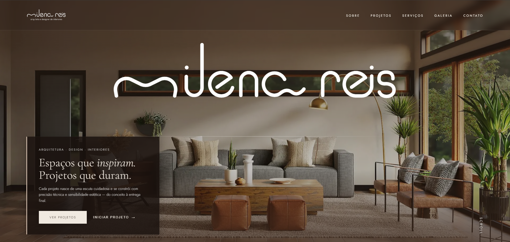
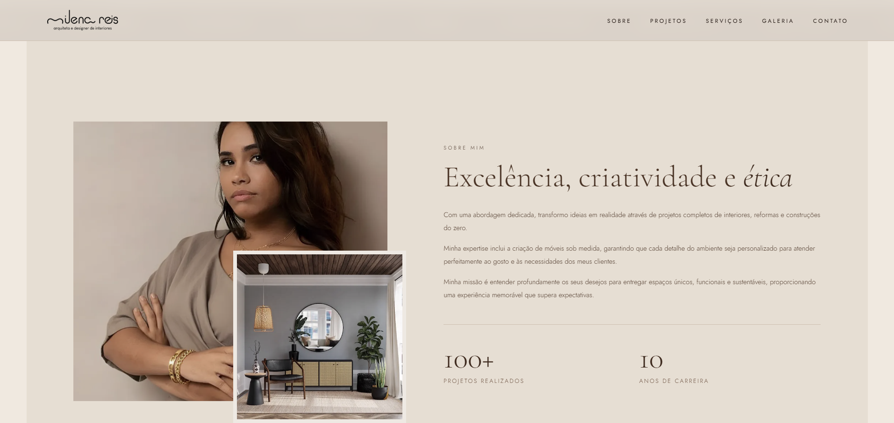
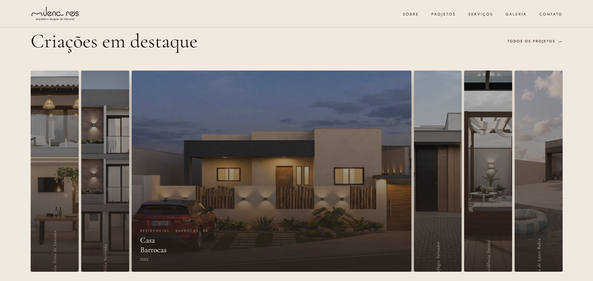
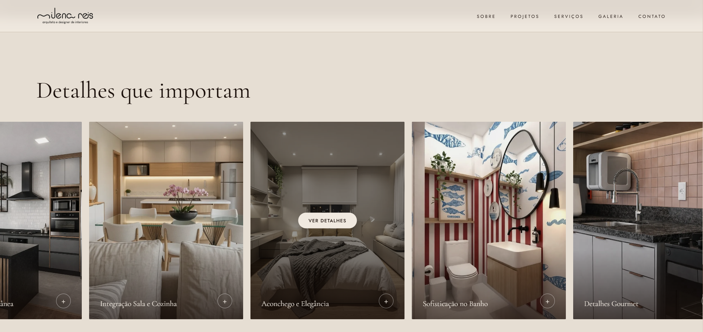
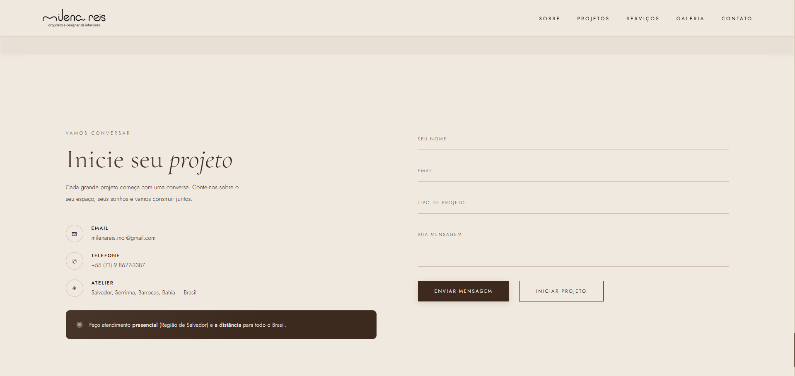
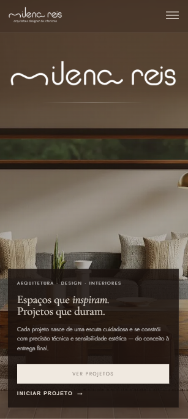
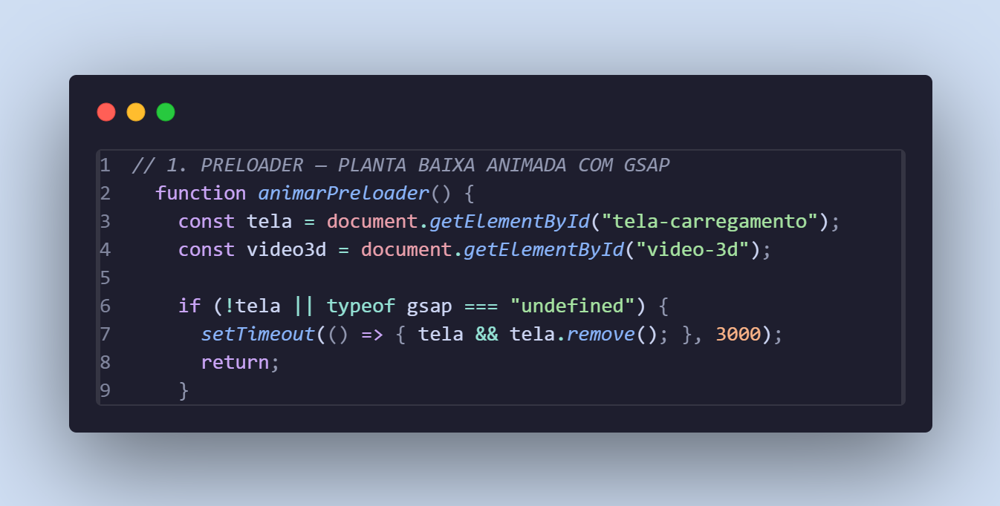
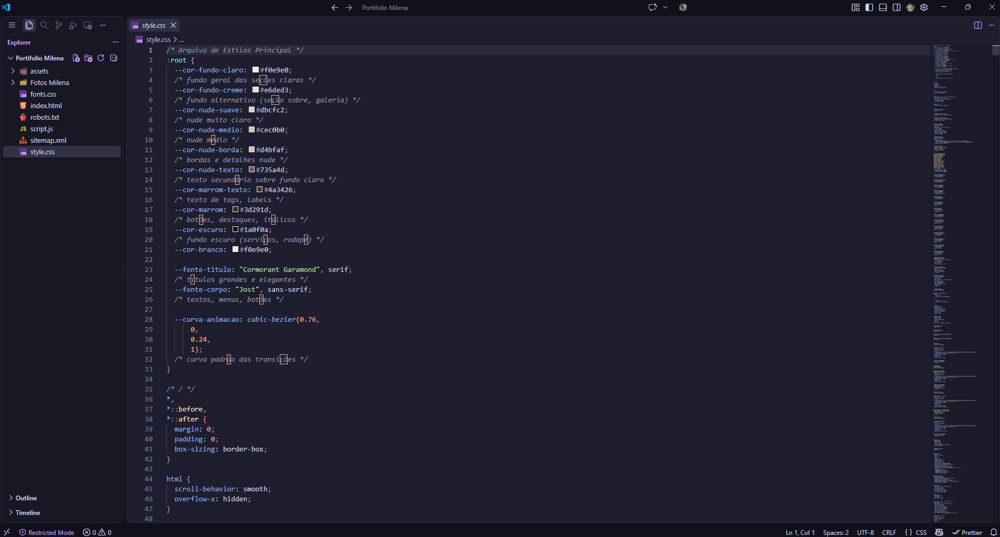

# 🏛️ Milena Reis — Arquitetura & Design de Interiores

<div align="center">

  

  <br/><br/>

  [](https://developer.mozilla.org/pt-BR/docs/Web/HTML)
  [](https://developer.mozilla.org/pt-BR/docs/Web/CSS)
  [](https://developer.mozilla.org/pt-BR/docs/Web/JavaScript)
  [](https://greensock.com/gsap/)
  [](https://greensock.com/scrolltrigger/)
  [](https://schema.org/)
  [](#design-system--estética)

  <p align="center">
    <strong>Website institucional e portfólio interativo de alto padrão desenvolvido para a arquiteta e designer de interiores Milena Reis.</strong>
    <br />
    Uma experiência digital refinada que une estética minimalista aquecida, animações fluidas baseadas em física e engenharia front-end moderna.
  </p>

  <p align="center">
    <a href="#-visão-geral">Visão Geral</a> •
    <a href="#-galeria-visual-do-projeto">Galeria Visual</a> •
    <a href="#-principais-recursos-e-engenharia">Recursos & Engenharia</a> •
    <a href="#-tecnologias-utilizadas">Tecnologias</a> •
    <a href="#-design-system--identidade-visual">Design System</a> •
    <a href="#-seo--performance">SEO & Performance</a> •
    <a href="#-estrutura-do-projeto">Estrutura</a> •
    <a href="#-como-executar">Como Executar</a>
  </p>

</div>

---

## 📖 Visão Geral

O projeto **Milena Reis Arquitetura** foi idealizado para refletir no meio digital o mesmo nível de sofisticação, precisão técnica e atenção aos detalhes característicos dos projetos arquitetônicos da profissional.

A plataforma apresenta um equilíbrio harmonioso entre fotografia editorial, tipografia clássica contemporânea, interatividade imersiva e conversão estratégica de leads para orçamentos via WhatsApp.

### 🌟 Destaques de Destaque:
- **Preloader Conceitual**: Uma planta baixa arquitetônica desenhada linha a linha via SVG animado com GSAP enquanto calcula a porcentagem de carregamento.
- **Scroll-Scrubbing de Vídeo 3D**: Render arquitetônico 3D sincronizado frame a frame com a rolagem da página através do GSAP ScrollTrigger.
- **Showcase de Projetos em Cartas**: Efeito de sanfona/deck interativo que expande cada projeto ao passar o mouse ou tocar.
- **Galeria Draggable com Modal**: Carrossel horizontal arrastável contínuo com zoom e inspeção detalhada em janela modal.
- **Wizard de Orçamento Multi-Step**: Formulário guiado em 3 etapas com validações e direcionamento automático para conversa no WhatsApp com texto estruturado.

---

## 📸 Galeria Visual do Projeto

Abaixo estão capturas reais de cada seção e módulo interativo construído na plataforma:

### 1. Capa Principal (Hero Section)
*Design editorial com tipografia marcante, fundo fotográfico imersivo, efeito de revelação suave e chamada para ação imediata.*

<div align="center">
  
</div>

<br/>

### 2. Sobre Mim & Métricas de Autoridade
*Composição assimétrica com retrato autoral, detalhe sobreposto, tipografia animada palavra por palavra e contadores numéricos dinâmicos.*

<div align="center">
  
</div>

<br/>

### 3. Portfólio Interativo — Criações em Destaque
*Baralho de projetos responsivo onde cada card se expande e revela as informações de localização, categoria e ano com transições fluidas em CSS.*

<div align="center">
  
</div>

<br/>

### 4. Galeria de Detalhes com Modal de Inspeção
*Carrossel contínuo de detalhes arquitetônicos com suporte a arraste com mouse/touch e modal com ficha técnica do ambiente.*

<div align="center">
  
</div>

<br/>

### 5. Seção de Contato, Atendimento & Rodapé
*Área de contato direto com formulário limpo em floating labels, cartões informativos de atendimento presencial/remoto e rodapé integrado.*

<div align="center">
  
</div>

<br/>

### 6. Experiência Mobile Responsiva & Código Limpo
*Adaptação impecável para telas verticais (smartphones/tablets) e arquitetura modular de código inspecionada no ambiente de desenvolvimento.*

<div align="center">
  <table>
    <tr>
      <td width="35%" align="center">
        <strong>📱 Versão Mobile (Smartphones)</strong><br/><br/>
        
      </td>
      <td width="65%" align="center">
        <strong>📐 Animação de Planta Baixa SVG (Preloader)</strong><br/><br/>
        
        <br/><br/>
        <strong>💻 Estrutura de Código no VS Code</strong><br/><br/>
        
      </td>
    </tr>
  </table>
</div>

---

## ⚡ Principais Recursos e Engenharia

### 1. Preloader Conceitual com Planta Baixa em SVG
- **Animação Vetorial de Traço**: Utiliza manipulação direta das propriedades `strokeDasharray` e `strokeDashoffset` para simular o desenho técnico à mão de paredes externas, divisórias internas, portas com raio de abertura, janelas, degraus e cotas.
- **Contador Dinâmico 0–100%**: Sincronizado pela timeline do GSAP com easing cúbico (`power2.inOut`), culminando na transição suave para o Hero com desfoque reverso.

### 2. 3D Architectural Video Scroll-Scrub
- **GSAP ScrollTrigger Pinned Section**: Fixa a seção na tela enquanto o usuário rola, mapeando o progresso do scroll diretamente no `currentTime` do vídeo em HTML5 (`Animation_1080_kf.webm` / `.mp4`).
- **Loop Suave de Renderização**: Implementado com `requestAnimationFrame` para contornar gargalos de decodificação de vídeo (*seeking latency*), garantindo suavidade absoluta em desktops e mobile.
- **Tratamento Mobile/iOS Safari**: Configuração explícita de `muted`, `playsinline` e pré-carregamento assíncrono para garantir suporte nativo sem travamento do navegador.
- **Narrativa Tipográfica**: Frases conceituais surgem e desaparecem com desfoque gaussiano dinâmico conforme o avanço do render 3D.

### 3. Deck Expansível de Projetos (Sanfona Interativa)
- Layout flexível onde o card sob foco ganha destaque visual imediato enquanto os demais recuam suavemente.
- Otimização pura em CSS com transições aceleradas por GPU (`transform`, `flex-grow`, `filter`).

### 4. Galeria Draggable Infinita
- Suporte duplo a **arraste com cursor (mouse drag)** no desktop e **gestos de toque (touch swipe)** no mobile.
- **Auto-scroll contínuo**: Loop infinito suave pausado automaticamente quando o usuário interage ou quando a janela modal de análise de detalhe está aberta.

### 5. Wizard de Orçamento Guiado (Funil de Vendas)
- Modal com barra de progresso e 3 etapas intuitivas:
  1. **Tipologia**: Seleção visual entre projeto Residencial ou Comercial.
  2. **Escopo**: Cidade/Estado e descrição dos ambientes desejados.
  3. **Identificação**: Nome, e-mail e WhatsApp com máscara automática `(XX) XXXXX-XXXX`.
- Ao finalizar, a aplicação formata uma mensagem completa com os dados coletados e abre diretamente o chat oficial do WhatsApp com a arquiteta.

### 6. Desfoque Dinâmico entre Seções (Depth of Field)
- Efeito de profundidade de campo calculado em tempo real via JavaScript com base na distância de cada seção em relação ao centro da viewport. Conforme uma seção sai de foco, ela recebe um leve blur, direcionando a atenção visual do usuário para o conteúdo ativo.

---

## 🛠️ Tecnologias Utilizadas

| Tecnologia | Finalidade no Projeto |
| :--- | :--- |
| **HTML5 Semântico** | Marcação estrutural moderna (`<main>`, `<section>`, `<nav>`, `<footer>`, tags de acessibilidade ARIA). |
| **CSS3 Avançado** | Variáveis customizadas (Design Tokens), Flexbox, CSS Grid, Glassmorphism (`backdrop-filter`), transições em curvas Bézier. |
| **JavaScript (ES6+)** | Lógica de estado dos modais, carrossel interativo, cálculos de scroll, observers e integração com API WhatsApp. |
| **GSAP (GreenSock 3.12)** | Motor de alta performance para a timeline do preloader, contadores e orquestração de elementos. |
| **GSAP ScrollTrigger** | Controle frame a frame da reprodução do vídeo 3D vinculado à rolagem da página. |
| **SVG Vetorial** | Desenho arquitetônico escalável e interativo utilizado na tela de carregamento. |
| **Intersection Observer API** | Gatilho para animações de fade-up, entrada lateral e contadores de estatísticas sob demanda (zero lag de scroll). |
| **WebP Image Format** | Formato de última geração para todas as fotografias com compressão superior e carregamento instantâneo. |
| **Google Fonts** | Fontes tipográficas de alta legibilidade e estilo editorial (`Cormorant Garamond`, `Jost`). |
| **Schema.org / JSON-LD** | Marcação de dados estruturados para SEO profissional (entidade `ProfessionalService` no Google). |
| **Vercel Functions + API do GitHub** | Painel de projetos sem banco de dados: publicar é criar um commit no repositório. |
| **Vercel Web Analytics** | Contagem de visitantes e page views, sem cookies, via script `/_vercel/insights/script.js`. |

---

## 🎨 Design System & Identidade Visual

A identidade visual foi concebida no estilo **Minimalismo Quente (*Warm Minimalism*)**, transmitindo aconchego, sofisticação e brasilidade através de uma paleta de tons terrosos e nudes.

### 🎨 Paleta de Cores

```css
:root {
  --cor-fundo-claro:   #f0e9e0; /* Nude marfim para planos de fundo principais */
  --cor-fundo-creme:   #e6ded3; /* Creme suave para alternância de seções */
  --cor-nude-suave:    #dbcfc2; /* Detalhes sutis e trilhas de scrollbar */
  --cor-nude-medio:    #cec0b0; /* Linhas divisórias e bordas secundárias */
  --cor-nude-borda:    #d4bfaf; /* Contornos elegantes de cartões e inputs */
  --cor-nude-texto:    #735a4d; /* Tipografia secundária e legendas */
  --cor-marrom-texto:  #4a3426; /* Tags, badges e títulos intermediários */
  --cor-marrom:        #3d291d; /* Cor primária de botões e itálicos destacados */
  --cor-escuro:        #1a0f0a; /* Fundo do preloader, serviços e rodapé */
}
```

### ✍️ Tipografia

- **Títulos e Destaques Editoriais**: `Cormorant Garamond` (serifa clássica, proporcionando ritmo e requinte de revista de arquitetura).
- **Corpo, Menus e Botões**: `Jost` (Sans-serif geométrica limpa e funcional inspirada no design Bauhaus).

---

## 🚀 SEO & Performance

O código foi construído sob rigorosos padrões para máxima velocidade de carregamento e indexação pelos mecanismos de busca:

- **Dados Estruturados JSON-LD**: Implementação de dados Schema.org para o tipo `ProfessionalService`, contendo nome comercial, localização em Salvador-BA, área de atendimento, telefone, e-mail e redes sociais.
- **Meta Tags Open Graph & Twitter Cards**: Pré-visualizações ricas ao compartilhar o link no WhatsApp, Instagram, LinkedIn e Facebook, com imagem dedicada de 1200×630 (`assets/og/og-image.jpg`).
- **Estratégia de Carregamento de Recursos**:
  - Imagem do Hero carregada com prioridade máxima (`preload` + `loading="eager" fetchpriority="high"`).
  - Todas as demais imagens carregadas de forma assíncrona com `loading="lazy"` e `decoding="async"`.
  - Scripts carregados com atributo `defer` e fontes com `preconnect`, sem bloquear a renderização.
- **Arquivos de Rastreamento**: `sitemap.xml` e `robots.txt` configurados e incluídos na raiz.
- **Página 404 personalizada** (`404.html`) e cabeçalhos de cache/segurança em `vercel.json`.
- **Acessibilidade**: navegação por teclado nos modais (Esc, foco, `inert`), `aria-*` no menu, suporte a `prefers-reduced-motion` e fallback sem JavaScript.

---

## 📁 Estrutura do Projeto

```text
Portifolio-Milena/
├── assets/
│   ├── galeria/             # Imagens dos ambientes em alta resolução (WebP)
│   ├── hero/                # Background principal da seção de entrada
│   ├── icones/              # Favicon e apple-touch-icon
│   ├── logo/                # Variações clara e escura da marca vetorial
│   ├── projetos/            # Imagens dos projetos arquitetônicos
│   ├── screenshots/         # Capturas de tela utilizadas na documentação
│   │   ├── About.png
│   │   ├── Destaques.png
│   │   ├── Detalhes.png
│   │   ├── Footer.png
│   │   ├── HomePage.png
│   │   ├── HomePageMobile.png
│   │   ├── PreloaderCode.png
│   │   └── PrintVscode.png
│   ├── og/                  # Imagem de compartilhamento (Open Graph, 1200×630)
│   ├── sobre/               # Retratos e fotos de perfil da arquiteta
│   ├── texturas/            # Textura sutil aplicada no fundo das seções
│   └── video/               # Renders 3D (.webm e .mp4) para o scroll-scrub
├── api/                     # Funções serverless da Vercel usadas pelo painel
│   ├── login.js             # Troca a senha por um token de sessão
│   ├── projetos.js          # Lê e publica a lista de projetos (commit no GitHub)
│   ├── imagem.js            # Recebe cada foto nova
│   └── _lib/                # Autenticação, API do GitHub e validação
├── css/
│   ├── style.css            # Folha de estilos global e responsiva (seções numeradas)
│   ├── projetos.css         # Estilos exclusivos da página de projetos
│   └── admin.css            # Estilos do painel
├── dados/
│   └── projetos.json        # Lista de projetos exibida em projetos.html
├── js/
│   ├── script.js            # Orquestração de animações, GSAP e interações
│   ├── projetos.js          # Monta a grade, os filtros e o modal a partir do JSON
│   └── admin.js             # Lógica do painel (login, editor, envio de fotos)
├── Fotos Milena/            # Fotos reais dos projetos (cards e galeria), em WebP
├── imagens-novas/           # Entrada de fotos originais (PNG/JPG) a converter — fora do git
├── scripts/
│   └── converter-imagens.mjs  # Converte imagens-novas/ para WebP (usa ffmpeg)
├── 404.html                 # Página de erro personalizada
├── admin.html               # Painel para gerenciar os projetos (com senha)
├── index.html               # Home: estrutura semântica completa e Schema.org
├── projetos.html            # Página com todos os projetos e seus detalhes
├── robots.txt               # Diretrizes para indexadores e crawlers
├── sitemap.xml              # Mapa do site para motores de busca (SEO)
├── vercel.json              # Cabeçalhos de cache e segurança do deploy
└── README.md                # Documentação técnica do projeto
```

### 🔐 Painel de projetos

Em `/admin.html` a arquiteta adiciona, edita, reordena e exclui projetos sem tocar em código. As fotos são reduzidas e convertidas para WebP no próprio navegador. Ao clicar em **Publicar no site**, o painel grava as fotos e o `dados/projetos.json` em um único commit no GitHub, e a Vercel republica o site em cerca de um minuto.

Configuração (uma vez só), em **Vercel → Settings → Environment Variables**:

| Variável | Valor |
| :--- | :--- |
| `ADMIN_SENHA` | Senha do painel (mínimo de 10 caracteres; use uma senha longa e única). |
| `GITHUB_TOKEN` | *Fine-grained personal access token* do GitHub com acesso **apenas a este repositório** e permissão **Contents: Read and write**. |

Depois de salvar as variáveis, faça um novo deploy. O painel só funciona no site publicado (as funções `/api` não existem em um servidor local estático).

### 🏠 Editando os projetos à mão

A página `projetos.html` é montada a partir de `dados/projetos.json`, o mesmo arquivo que o painel edita. Para incluir um projeto manualmente, adicione um item ao array (a ordem do arquivo é a ordem na tela):

```json
{
  "id": "casa-exemplo",
  "titulo": "Casa Exemplo",
  "categoria": "Residencial",
  "local": "Salvador, BA",
  "ano": 2026,
  "descricao": "Texto que aparece no detalhe do projeto.",
  "imagens": [
    { "src": "assets/projetos/casa-exemplo-fachada.webp", "alt": "Fachada da Casa Exemplo" }
  ]
}
```

`local`, `ano` e `area` são opcionais; a primeira imagem é a capa e as categorias viram filtros automaticamente. Cada projeto tem link próprio: `projetos.html#casa-exemplo`.

### 🖼️ Adicionando novas fotos

Coloque os arquivos originais (PNG/JPG) em `imagens-novas/` e rode:

```bash
node scripts/converter-imagens.mjs assets/projetos
```

Os `.webp` saem otimizados (máx. 1920px) e com nomes em `kebab-case`. Detalhes em [`imagens-novas/LEIA-ME.md`](imagens-novas/LEIA-ME.md).

---

## 💻 Como Executar Localmente

Como o projeto foi construído em **tecnologias puras (Vanilla Web)**, ele não requer instalação de gerenciadores de pacotes pesados como Node.js para rodar em sua máquina.

### Pré-requisitos:
- Um navegador web moderno (Google Chrome, Mozilla Firefox, Microsoft Edge ou Safari).
- Extensão [Live Server](https://marketplace.visualstudio.com/items?itemName=ritwickdey.LiveServer) no VS Code (recomendada para evitar bloqueios de CORS ao carregar fontes ou vídeos locais).

### Passo a passo:

1. **Clone o repositório:**
   ```bash
   git clone https://github.com/SchaideNunes/Portifolio-Milena.git
   ```

2. **Acesse a pasta do projeto:**
   ```bash
   cd Portifolio-Milena
   ```

3. **Inicie um servidor local:**
   - **Pelo VS Code**: Clique com o botão direito no arquivo `index.html` e selecione **"Open with Live Server"**.
   - **Ou pelo terminal (Python)**:
     ```bash
     python -m http.server 3000
     ```
   - Acesse no navegador: `http://localhost:3000`

---

## 👩‍💼 Créditos e Autoria

- **Cliente / Arquiteta**: [Milena Reis](https://www.instagram.com/milena_reis_arq/) — *Arquitetura e Design de Interiores*
- **Engenharia Front-End & Design Interativo**: [Schaide Nunes](https://github.com/SchaideNunes)

---

<div align="center">
  <sub>Desenvolvido com excelência técnica, precisão estética e dedicação aos detalhes. © 2026 Milena Reis Arquitetura.</sub>
</div>
